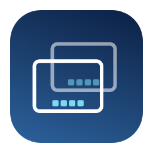
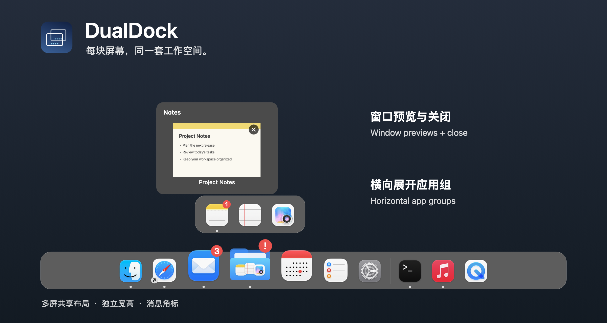

<div align="center">



# DualDock

### Apps neatly organized. A Dock on every display.

A native macOS Dock for multiple displays. Organize related apps into horizontal groups,
preview their windows, and keep the same layout on your MacBook and external monitors.

[](LICENSE)
[](#requirements)
[](https://github.com/autumncry/DualDock/releases/latest)
[](https://github.com/autumncry/DualDock/releases/latest)

[简体中文](README.md) &nbsp;·&nbsp; **English**

[**Download**](https://github.com/autumncry/DualDock/releases/latest) &nbsp;·&nbsp; [**Build from source**](#building-from-source) &nbsp;·&nbsp; [**Report an issue**](https://github.com/autumncry/DualDock/issues)

</div>

<div align="center">
  
  <p><sub>Example layout rendered with actual AppKit components and sample content.</sub></p>
</div>

## Why DualDock

When your workspace extends beyond a laptop, your everyday apps should stay within reach. DualDock focuses on multiple displays and app groups, keeping a familiar starting point on each screen.

- **A shared layout.** Every extended display gets a Dock, with the same apps, groups, order, and display mode.
- **Apps organized around your work.** Group related apps, open them in a horizontal strip, and rearrange members whenever you need.
- **Source you can change.** Built with Swift, AppKit, and SwiftUI, and released under the MIT license.

## Features

### A Dock on each display

Use DualDock on your MacBook display and external monitors at the same time. It responds to display changes; mirrored displays follow the image duplicated by macOS. When an app enters full screen, DualDock hides only on that display.

### App groups and drag-and-drop

Drag apps in from Finder or add them through Settings. Drop near an icon's edge to reorder; hold over its center for about 0.6 seconds before dropping to create an app group.

Click a folder icon to expand its members horizontally. Reorder apps within a group, move them back to the main Dock, or use the context menu to rename or dissolve a group. The first launch imports pinned apps from the system Dock. DualDock then maintains its own layout; re-importing adds missing apps while preserving existing groups.

### Preview, switch, and close windows

Hover over a running app to see window thumbnails. Click a thumbnail to switch to that window, or use the **×** in its upper-right corner to request closing it. The original app handles any unsaved-changes confirmation. Closing dismisses the current preview; the next hover reads the window list again.

Windows without a usable screenshot are omitted. Screenshots are processed in local memory, without being saved to disk or uploaded.

### Two display modes

- **Pinned apps and groups + running apps:** keep your usual shortcuts alongside running apps that are not pinned.
- **Running apps only:** show regular running apps in a flat row, including hidden or minimized apps and apps on other Spaces. Switching back restores the saved groups and order.

Change the mode in Settings; every display updates together.

### Fully adaptive system Dock sizing

Enable “完全自适应系统 Dock” to follow the system Dock's base icon size, bar thickness, icon spacing, end padding, and magnification. The bar grows or shrinks with the app count and stays centered on its display edge. Hovering changes the icons while keeping the backdrop fixed.

Adaptive mode hides manual size and magnification controls and disables edge resizing. Turning it off restores the previous manual configuration. Users who enabled automatic width in an earlier version are migrated to fully adaptive sizing.

Dimensions are read from system preferences and Accessibility geometry without changing them. Temporary read failures retain the latest valid measurement; compatible values are used when there is no prior measurement. Accessibility bounds can differ from actual system rendering, so pixel-identical results are not guaranteed.

### Per-display position and manual sizing

Choose **bottom, top, left, or right** independently for each display. Top and bottom Docks use horizontal rows; side Docks use vertical rows with upright icons. App groups still expand horizontally, and popups open toward the inside of the screen.

Manual mode provides length, thickness, icon-size, and spacing sliders. You can also resize the Dock directly:

- **Inward edge:** adjust thickness.
- **Either endpoint:** adjust length while keeping the bar centered.
- **Two inward corners:** scale proportionally.

Icon size is saved as a relative proportion, preserved when thickness changes or the bar is scaled. Spacing changes only the contents of the fixed bar. Overflow scrolls along the Dock's direction without a visible scrollbar.

“所有屏幕同步尺寸” synchronizes sizes using the range available to all displays. Turn it off to configure each display within its own available bounds. Turning synchronization back on adopts the **currently selected display's effective size**, while positions remain independent. Manual thickness is capped at **12%** of the available short edge; maximum length follows the available length of the selected edge. Dimensions use macOS logical points.

### Shape the magnification curve

In manual mode, the Interaction page provides two continuous sliders:

- **Peak size (放大峰值):** the maximum size of the icon under the pointer.
- **Influence range (联动范围):** how many neighboring icons join the wave. Narrowing it reduces magnification around the focused icon.

A curve preview updates with the sliders while the Dock backdrop stays fixed. Both controls are disabled when magnification is off. Fully adaptive mode continues to follow the system Dock and hides the manual curve controls. Your previous manual peak is preserved, and the new range initially matches the earlier behavior.

### Hide when windows overlap

Enable “窗口遮挡时隐藏 Dock” in Interaction to hide a display's Dock when a normal window overlaps its area. Pause the pointer at that edge to reveal it. For a top Dock, the activation edge sits below the menu bar.

The Dock stays available while you use a group, preview, context menu, or drag operation, then hides after you leave. Native full-screen apps take priority and keep the Dock hidden even at the edge. This option is off by default and does not resize other apps' windows.

### Sidebar settings

Settings use a category sidebar with configuration on the right: **General, Appearance & Size, Displays & Position, Interaction, Permissions, Help, and About**. The window can be resized and minimized. About includes the version, MIT license, and project links. The app interface remains in Simplified Chinese.

### More details

- **Notification badges:** individual apps show the labels supplied by the system; a group shows a red **!** when a member has an unread indicator. A global switch disables badges. Only badge state is read, not notification text. Some apps may not provide a usable label.
- **System Dock management:** optionally hide the system Dock. The preferences changed by DualDock are restored on normal exit, or recovered at the next launch after an interruption; later manual changes are preserved. A manual restore command is also available in the menu bar.
- **Quick access to Settings:** right-click a blank area of the Dock, or use the overlapping-rectangles icon in the menu bar.
- **Local configuration:** groups, order, and preferences live in `~/Library/Application Support/DualDock/`, with migration backups created when needed.

## Download and install

Download the latest `DualDock-<version>-arm64.dmg` and optional SHA-256 checksum from [Releases](https://github.com/autumncry/DualDock/releases/latest).

1. Open the DMG and drag `DualDock.app` into `Applications`.
2. Launch DualDock and grant **Screen Recording** and **Accessibility** access in its Permissions settings.
3. Choose the display mode, adaptive or manual sizing, and each display’s position in Settings, then organize app groups with drag-and-drop. Hiding the system Dock is off by default and can be enabled when desired.

Screen Recording provides window thumbnails; Accessibility identifies, activates, and closes windows, and reads system Dock layout and badge information. If a permission change does not take effect, quit and reopen DualDock. To update, download the new DMG and replace the app; your local configuration is retained.

> [!NOTE]
> The current release targets Apple Silicon and uses an ad-hoc signature for personal use. It is not notarized by Apple. If macOS blocks the first launch, consult the [installation notes](docs/installation.txt) (Chinese).

## Building from source

```sh
git clone https://github.com/autumncry/DualDock.git
cd DualDock
./script/build_and_run.sh
```

This is a Swift Package Manager project; no Xcode project needs to be created. The script first asks an existing DualDock process to quit normally, then builds, bundles, locally signs, and launches `dist/DualDock.app`.

### Requirements

- Runtime: macOS 14 or later. The distributed DMG is built for Apple Silicon (arm64).
- The current app interface is in Simplified Chinese.
- Build tools: Xcode or command-line tools supporting Swift tools version 5.9 and the corresponding macOS SDK.

### Build and validation commands

```sh
./script/build_and_run.sh --build-only # Build the .app without launching it
./script/build_and_run.sh --verify     # Build, launch, and check the process
./script/package_dmg.sh               # Release build, DMG, and SHA-256
swift test -c release                 # Model, layout, and window-policy tests
./script/check_dock_views.sh          # Hidden AppKit component checks
./script/check_four_edge_views.sh     # Four-edge layout, scroll, and input routing
./script/check_display_sizing_store.sh # Per-display sizing, sync, and resize commits
./script/check_native_dock_metrics.sh # Native Dock measurement and fallback checks
./script/check_dock_animation.sh      # Hover redraw, layout, and badge regressions
./script/check_dock_visibility.sh     # Visibility timing and lifecycle checks
./script/check_fullscreen_fallback.sh # Async fullscreen fallback and stale results
./script/check_window_obstruction.sh  # Obstruction reads, caching, and coalescing
./script/check_application_activation.sh # App and helper-process activation routing
./script/check_badges.sh              # Badge reads and asynchronous state checks
./script/check_system_dock.sh         # Isolated system Dock recovery checks
```

The build-and-run script also supports `--logs`, `--telemetry`, and `--debug`. Test instances can use the `.app` launch arguments `--config-dir <directory>` for isolated configuration and `--diagnostics <JSON path>` for layout diagnostics.

## Documentation

- [Installation notes](docs/installation.txt) (Chinese)
- [Validation records and known limitations](docs/validation.md) (Chinese)
- [Implementation research and initial design](docs/superpowers/specs/2026-11-09-dualdock-design.md) (Chinese)
- [2.0 adaptive sizing, per-display positions, and resizing](docs/superpowers/specs/2026-11-10-four-edge-adaptive.md) (Chinese)
- [2.1 visibility, activation, and animation changes](docs/superpowers/specs/2026-11-11-visibility-and-motion.md) (Chinese)

Window identity matching and full-screen detection use optional macOS private interfaces with fallbacks. macOS updates may require adjustments. Preview and window-control behavior for minimized windows, other Spaces, and protected content depends on the target app and macOS.

## Feedback and contributions

Use [Issues](https://github.com/autumncry/DualDock/issues) for bug reports and suggestions. Please include the DualDock and macOS versions, display setup, and reproduction steps; redact private content before sharing screenshots. Pull requests are welcome.

The README presentation takes inspiration from [Docky](https://github.com/josejuanqm/docky). The text, branding, and demo content here are specific to DualDock.

## Dependencies

No third-party Swift Package dependencies. DualDock primarily uses system frameworks including AppKit, SwiftUI, ScreenCaptureKit, Accessibility, and CoreGraphics.

## License

[MIT License](LICENSE). Copyright © 2026 Ronny Cao.
