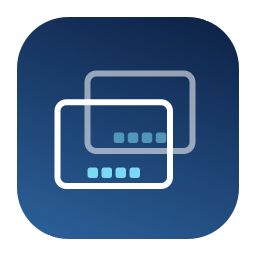
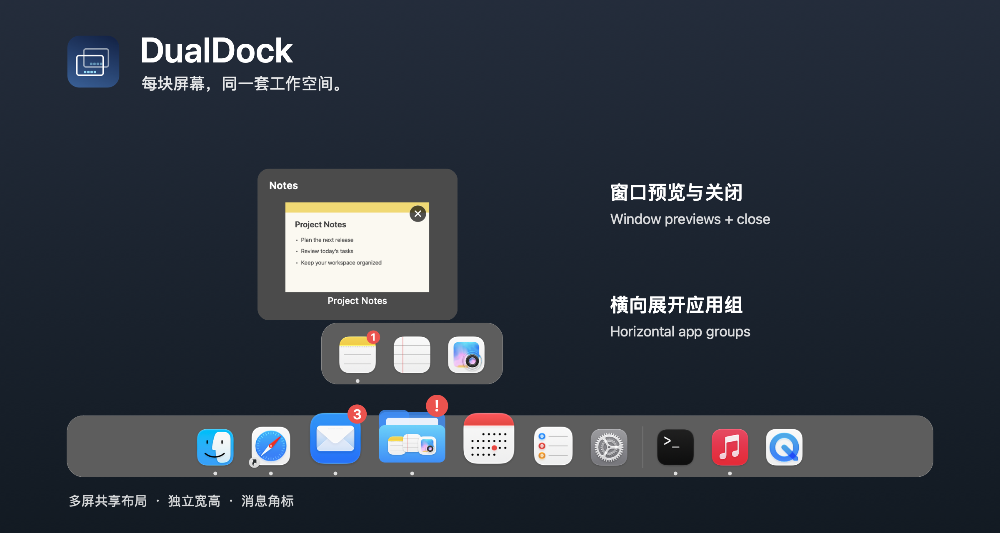
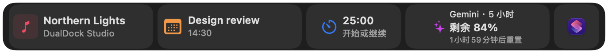

<div align="center">



# DualDock

[简体中文](README.md) · **English** · [Download for macOS](https://github.com/autumncry/DualDock/releases/latest)

</div>

## A Dock on each display

DualDock shows a Dock on your Mac’s built-in screen and external displays at the same time. Your MacBook can show apps along the bottom while an external monitor shows music and calendar events on its right edge. Each display remembers its Dock position and current page. Displays share the same app groups and tools layout.

When an app goes full screen, the Dock hides on that display. Hold the pointer at its edge to bring it back.



## Apps and tools

On the **Apps page**, drag apps together to group them. Hover over an app to preview its windows, then click a thumbnail to bring that window forward.

The **Tools page** holds music, calendar, weather, system stats, shortcuts, and quota cards for Codex, Gemini, Claude and Cursor. Swipe with two fingers over the Dock to switch pages. Swipe up or down on a horizontal Dock, or left or right on a vertical Dock. You can also switch from the menu bar. [Tool settings and quota sources](docs/tools.en.md)



## Download and install

Requires an **Apple Silicon Mac running macOS 14 or later**. Download the DMG from [GitHub Releases](https://github.com/autumncry/DualDock/releases/latest) and drag `DualDock.app` into Applications. DualDock uses Screen Recording permission for window previews and Accessibility permission to switch or close windows.

On version 2.8.0 or later, choose **Settings → Support → About DualDock → Check for Updates**. If an older preview configuration is found, DualDock backs up your release settings before importing the preview’s groups and tools layout. [Installation and upgrade notes (Chinese)](docs/installation.txt)

<details>
<summary><strong>First launch blocked? Open Anyway instructions and optional Terminal commands</strong></summary>

<!-- first-launch-guidance:start -->
### First launch: Apple cannot verify the app or developer

The current release is not Apple Developer ID signed or notarized. macOS may say that Apple cannot verify DualDock or that the developer cannot be verified. **Proceed only if you obtained the app from this project's [official Releases](https://github.com/autumncry/DualDock/releases/latest), trust its source, have checked that it was not tampered with, and choose to open it.** This approval applies to this app:

1. After copying DualDock to Applications, try opening it once, then dismiss the verification alert.
2. Open **System Settings → Privacy & Security**, scroll to Security, and find the blocked DualDock entry. Click **Open Anyway**; some macOS versions first show an **Open** entry.
3. Authenticate with your login password or Touch ID when requested, then confirm **Open**. You can subsequently launch the app normally.
4. If the button is missing, try opening DualDock from Applications again, then return to this page. Apple says the option is available for about one hour after an attempted launch. On a managed Mac, contact your administrator if the option is restricted.

#### Optional: open from Terminal

If you choose the command-line route, first confirm that the app came from the official Releases above, trust its source, check that it was not tampered with, and copy it to `/Applications/DualDock.app`. Open Terminal and run these commands in order:

```sh
xattr -dr com.apple.quarantine "/Applications/DualDock.app"
open "/Applications/DualDock.app"
```

The first command removes only the `com.apple.quarantine` attribute from this app bundle and its contents. It does not clear other extended attributes or disable Gatekeeper system-wide. The second command launches the app. This does not sign or notarize the app, or grant Accessibility or Screen Recording access; grant those permissions separately when using the app. Keep the complete path unchanged and do not add `sudo` by default. If you encounter a permission error, use the System Settings route above.

This route has been confirmed on a user's Mac; it has not been validated across all Macs or macOS versions.

If the alert says the app **will damage your computer**, contains detected malware, or **is damaged**, stop opening it. Download it again from official Releases and compare the SHA-256 checksum; [report the issue](https://github.com/autumncry/DualDock/issues) if it persists. These alerts differ from an unverified developer and should not be approved using the steps above. Do not disable system-wide security protections.

Apple guidance: [Safely open apps on your Mac](https://support.apple.com/en-us/102445) and [the per-app approval and its time limit](https://support.apple.com/en-gb/guide/mac-help/mh40617/mac).
<!-- first-launch-guidance:end -->

</details>

## Building from source

On macOS, use Xcode or Command Line Tools with Swift 5.9 or later.

```sh
git clone https://github.com/autumncry/DualDock.git
cd DualDock
./script/build_and_run.sh
```

[Report an issue](https://github.com/autumncry/DualDock/issues) · [Contributing](CONTRIBUTING.md) · [MIT license](LICENSE)
