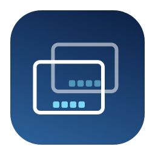
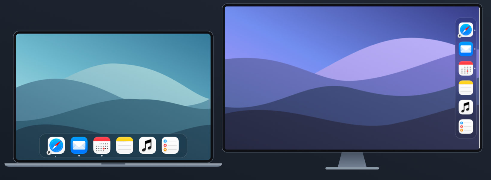
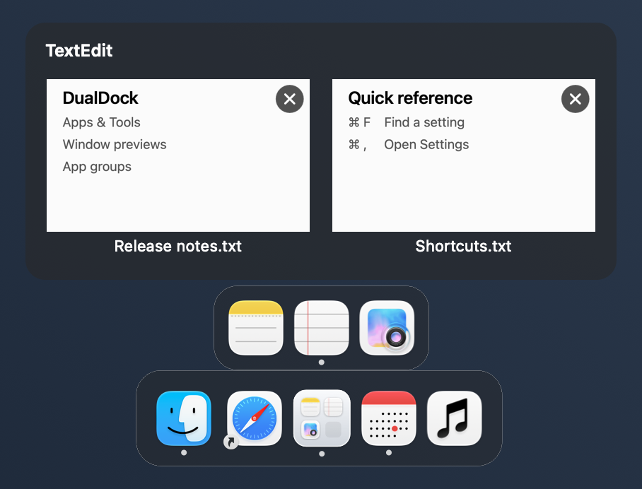
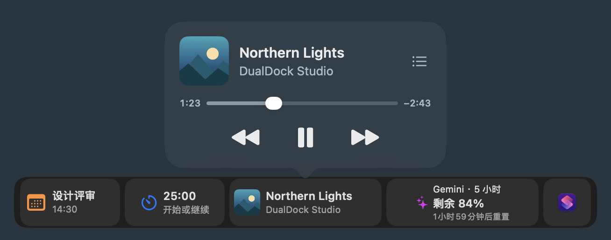

<div align="center">



# DualDock

**简体中文** · [English](README.en.md) · [下载 macOS 版](https://github.com/autumncry/DualDock/releases/latest)

</div>

## 多屏同时显示，按屏设置

Mac 内屏和外接显示器可以同时显示 Dock。每块屏幕可单独选择停靠边缘，并记住当前显示的应用页或工具页。手动尺寸可逐屏调整，应用分组和工具排列在各屏共享。



<sub>双屏演示截图并排展示。同一组应用在内屏停靠底部，在外接屏停靠右侧。</sub>

## 应用分组与窗口预览

把一个应用拖到另一个图标上即可建组，点击文件夹展开。悬停在运行中的应用上可预览窗口，点击缩略图将对应窗口带到前台。



## 双指切换工具页

在水平 Dock 上双指上滑打开工具页，下滑返回应用页。侧边 Dock 用左右滑动，也可以从菜单栏切页。

工具页可放音乐、日历、系统状态、快捷入口，以及 Codex、Gemini、Claude 和 Cursor 的额度卡。在「设置 → Dock → 工具页」点「编辑」，可拖动卡片、调整宽度。[工具页指南](docs/tools.md)



## 下载与安装

适用于 **Apple Silicon Mac，macOS 14 或更新版本**。从 [GitHub Releases](https://github.com/autumncry/DualDock/releases/latest) 下载 DMG，将 `DualDock.app` 拖入「应用程序」。窗口预览需要屏幕录制权限，切换和关闭窗口需要辅助功能权限。

已有 2.8.0 或更高版本可在「设置 → 支持 → 关于 DualDock」中检查更新。若检测到旧试用版配置，升级时会先备份正式版配置，再导入试用版的分组与工具排列。[安装与升级说明](docs/installation.txt)

<details>
<summary><strong>首次启动提示「Apple 无法验证」或「无法验证开发者」？查看系统设置步骤和终端命令</strong></summary>

<!-- first-launch-guidance:start -->
### 首次启动：Apple 无法验证或无法验证开发者

当前发布包尚未经过 Apple Developer ID 签名和公证，首次打开可能出现“Apple 无法验证 DualDock 是否包含恶意软件”或“无法验证开发者”。**仅当安装包来自本项目的[官方 Releases](https://github.com/autumncry/DualDock/releases/latest)，且你确认来源可信、文件未被篡改并决定继续时**，按以下步骤允许这一个应用：

1. 将应用拖入“应用程序”后，先尝试打开 DualDock；出现上述提示后关闭提示。
2. 打开 **系统设置 → 隐私与安全性**，向下滚动到“安全性”，找到 DualDock 的阻止记录，点击 **仍要打开（Open Anyway）**；部分系统会先显示“打开”入口。
3. 按系统要求验证登录密码或 Touch ID，然后在确认提示中选择“打开”。之后可正常双击启动。
4. 如果没有找到该按钮，再次尝试打开“应用程序”中的 DualDock，然后返回此页面。Apple 说明此入口通常在尝试启动后约一小时内可用；受管理的 Mac 可能需要联系管理员。

#### 可选：使用终端打开

如果你选择命令行方式，请先确认应用来自上方官方 Releases、来源可信且未被篡改，并已复制到 `/Applications/DualDock.app`。打开“终端”，依次执行：

```sh
xattr -dr com.apple.quarantine "/Applications/DualDock.app"
open "/Applications/DualDock.app"
```

第一条命令仅移除这个应用包及其内部文件的 `com.apple.quarantine` 隔离属性，不清除其他扩展属性，也不关闭系统整体的 Gatekeeper。第二条启动应用。这不会为应用签名或公证，也不会授予辅助功能或屏幕录制权限；这些权限仍在首次使用时单独授权。请保持完整路径不变，不要默认添加 `sudo`；如遇权限错误，可使用上方系统设置方式。

该方法经用户本机验证可用，但未覆盖所有 Mac 和 macOS 版本。

如果提示明确指出应用“将损坏你的电脑”、检测到恶意软件或“已损坏”，请停止打开，从官方 Releases 重新下载并核对 SHA-256；仍有提示时[反馈问题](https://github.com/autumncry/DualDock/issues)。这与“无法验证开发者”不同，不应按上述流程放行。无需关闭系统的整体安全保护。

Apple 说明：[安全地打开 Mac 上的 App](https://support.apple.com/en-us/102445)、[单个应用的打开入口与有效时间](https://support.apple.com/en-gb/guide/mac-help/mh40617/mac)。
<!-- first-launch-guidance:end -->

</details>

## 从源码构建

使用支持 Swift 5.9 的 Xcode 或命令行工具，在 macOS 上运行：

```sh
git clone https://github.com/autumncry/DualDock.git
cd DualDock
./script/build_and_run.sh
```

[反馈问题](https://github.com/autumncry/DualDock/issues) · [贡献指南](CONTRIBUTING.md) · [MIT 许可证](LICENSE)
