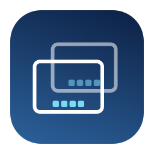
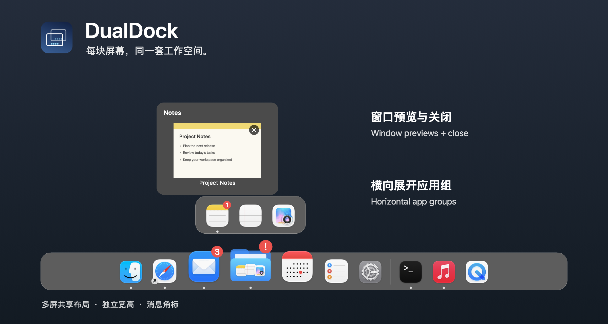

<div align="center">



# DualDock

### 应用有序收纳，Dock 多屏同在。

一款原生 macOS 多屏 Dock。把常用应用收进横向展开的应用组，悬停查看窗口，
在 MacBook 和外接显示器上使用同一套布局。

[](LICENSE)
[](#系统要求)
[](https://github.com/autumncry/DualDock/releases/latest)
[](https://github.com/autumncry/DualDock/releases/latest)

**简体中文** &nbsp;·&nbsp; [English](README.en.md)

[**下载最新版**](https://github.com/autumncry/DualDock/releases/latest) &nbsp;·&nbsp; [**从源码构建**](#从源码构建) &nbsp;·&nbsp; [**反馈问题**](https://github.com/autumncry/DualDock/issues)

</div>

<div align="center">
  
  <p><sub>演示布局，使用实际 AppKit 组件和示例内容绘制。</sub></p>
</div>

## 为什么选择 DualDock

工作空间从笔记本延伸到外接屏幕后，常用应用也应该随手可及。DualDock 围绕多屏和应用分组设计，让每块屏幕都保留熟悉的入口。

- **多屏共享。** 每个扩展屏幕都有一条 Dock，应用、分组、顺序和显示模式统一保存。
- **按工作方式整理。** 把相关应用归为一组，展开后横向排列，随时调整成员和顺序。
- **公开且可修改。** 使用 Swift、AppKit 和 SwiftUI 构建，源码采用 MIT 协议。

## 功能

### 每块屏幕都有 Dock

在 MacBook 内置屏和外接屏上同时显示 Dock。连接变化时自动调整，镜像屏幕由 macOS 复制对应画面。某块屏幕进入全屏应用时，只隐藏该屏的 DualDock。

### 应用分组与拖拽整理

从 Finder 拖入应用，或在设置中添加。拖到图标边缘可排序；在另一个应用图标中央停留约 0.6 秒再松开，即可合成应用组。

点击文件夹图标横向展开。成员支持组内重排、移回主栏；右键可重命名或拆分应用组。首次启动会导入系统 Dock 的固定应用，之后独立保存。“重新导入”会补入缺少的应用，并保留已有分组。

### 看清窗口，再切换或关闭

悬停运行中的应用查看窗口缩略图，点击预览切换到对应窗口，点击右上角 **×** 请求关闭该窗口。未保存内容仍由原应用提示确认。关闭后收起当前预览，再次悬停读取最新窗口列表。

无法取得有效截图的窗口不显示预览。截图仅在本机内存中处理，不保存到磁盘或上传。

### 两种显示模式

- **固定应用与分组 + 运行应用：** 保留常用入口，并显示未固定的运行应用。
- **仅正在运行的应用：** 平铺所有普通运行应用，包括隐藏、最小化和其他桌面的应用；切回普通模式会恢复原来的分组与排列。

显示模式在设置页切换，所有屏幕同步生效。

### 完全自适应系统 Dock

开启“完全自适应系统 Dock”后，基础图标大小、栏厚度、图标间距、两端留白和悬停放大一起跟随系统 Dock。栏的长度随应用数量增减，并在所在屏幕边缘居中；悬停只改变图标，不改变底板。

自适应模式隐藏手动尺寸与放大控件，也不支持边缘拖动。关闭后恢复原有手动配置。升级前已开启“自动调整 Dock 宽度”的用户会进入完整自适应模式。

尺寸通过只读系统偏好与辅助功能布局获取。系统 Dock 暂时不可读时沿用最近一次有效尺寸；没有历史值时采用兼容值。辅助功能边界与系统实际绘制可能存在差异，不保证逐像素一致。

### 每屏位置与手动尺寸

每块屏幕可独立选择**底部、顶部、左侧或右侧**。上下位置为横排，左右位置为竖排，图标始终保持正向；应用组仍横向展开，弹窗朝屏幕内侧显示。

手动模式提供长度、厚度、图标大小和间距滑块，也可以直接拖动 Dock：

- **内侧边：** 调整厚度。
- **两端：** 调整长度，保持居中。
- **内侧两个角：** 等比缩放。

图标大小以相对比例保存，后续调整厚度或等比缩放时保留该比例。间距只改变固定栏内的排列；内容超出时可沿 Dock 方向滚动，不显示滚动条。附近图标平滑联动放大，支持手动开关和幅度调整。

“所有屏幕同步尺寸”可统一调整各屏，限制取所有屏幕共同可用的范围；关闭后，每屏按自身可用范围分别设置。重新开启同步时，采用设置页**当前选中屏幕的有效尺寸**，各屏位置保持独立。手动厚度上限为可用短边的 **12%**，长度上限为所在边缘的可用长度，单位为 macOS 逻辑点。

### 分页设置

设置采用左侧分类、右侧配置的布局，包含**通用、外观与尺寸、屏幕与位置、交互、权限、使用方法、关于**。窗口支持缩放和最小化，“关于”页提供版本、MIT 协议和项目链接。

### 更多细节

- **消息角标：** 单个应用显示系统提供的数量或标签，组内有未读提醒时显示红色 **!**；可统一关闭。只读取角标状态，不读取通知正文。部分应用可能不提供可用角标。
- **系统 Dock 管理：** 可选择隐藏系统 Dock；正常退出时恢复由 DualDock 修改的设置，异常退出后在下次启动时恢复，并保留之后手动更改的项目。菜单栏也提供手动恢复入口。
- **方便进入设置：** 右键 Dock 空白处，或点击菜单栏的双矩形图标。
- **本地配置：** 分组、排列和设置保存在 `~/Library/Application Support/DualDock/`，升级时按需保留迁移前备份。

## 下载与安装

前往 [Releases](https://github.com/autumncry/DualDock/releases/latest) 下载最新的 `DualDock-版本号-arm64.dmg`，以及可选的 SHA-256 校验文件。

1. 打开 DMG，将 `DualDock.app` 拖入 `Applications`。
2. 从“应用程序”启动 DualDock，在“权限”页授予**屏幕录制**和**辅助功能**权限。
3. 在设置中选择显示模式、自适应或手动尺寸，并为各屏设置位置，再通过拖拽整理应用组。系统 Dock 隐藏默认关闭，可按需启用。

屏幕录制用于窗口缩略图；辅助功能用于匹配、切换和关闭窗口，以及读取系统 Dock 的布局和角标。权限变更后如未生效，请退出并重新打开 DualDock。更新时下载新 DMG 并替换旧应用，本地配置会继续保留。

> [!NOTE]
> 当前发布包面向 Apple Silicon，采用个人自用的 ad-hoc 签名，尚未经过 Apple 公证。首次安装遇到系统提示时，请参阅[安装说明](docs/installation.txt)。

## 从源码构建

```sh
git clone https://github.com/autumncry/DualDock.git
cd DualDock
./script/build_and_run.sh
```

这是一个 Swift Package Manager 项目，无需创建 Xcode 工程。脚本会先请求已运行的 DualDock 正常退出，再构建、打包、本地签名并启动 `dist/DualDock.app`。

### 系统要求

- 运行环境：macOS 14 或更新版本；当前 DMG 为 Apple Silicon（arm64）构建。
- 当前应用界面为简体中文。
- 构建环境：支持 Swift tools version 5.9、包含相应 macOS SDK 的 Xcode 或命令行工具。

### 构建与检查命令

```sh
./script/build_and_run.sh --build-only # 生成 .app，不启动
./script/build_and_run.sh --verify     # 构建、启动并确认进程
./script/package_dmg.sh               # release 构建、DMG 与 SHA-256
swift test -c release                 # 模型、布局和窗口策略回归
./script/check_dock_views.sh          # 隐藏 AppKit 组件检查
./script/check_four_edge_views.sh     # 四向布局、滚动与输入路由检查
./script/check_display_sizing_store.sh # 各屏尺寸、同步与拖动提交检查
./script/check_native_dock_metrics.sh # 原生 Dock 尺寸读取与回退检查
./script/check_badges.sh              # 角标读取与异步状态检查
./script/check_system_dock.sh         # 隔离环境下的系统 Dock 恢复检查
```

构建运行脚本也支持 `--logs`、`--telemetry` 和 `--debug`。测试实例可通过 `.app` 启动参数 `--config-dir <目录>` 使用独立配置，或用 `--diagnostics <JSON 路径>` 输出布局诊断。

## 文档

- [安装说明](docs/installation.txt)
- [验证记录与已知边界](docs/validation.md)
- [实现分析与初始设计](docs/superpowers/specs/2026-11-09-dualdock-design.md)
- [2.0 自适应、每屏位置与拖动尺寸设计](docs/superpowers/specs/2026-11-10-four-edge-adaptive.md)

窗口身份匹配和全屏检测使用可选的 macOS 私有接口，并提供回退。系统升级后可能需要适配；最小化、其他桌面和受保护窗口的预览及操作能力取决于目标应用和 macOS。

## 反馈与贡献

欢迎通过 [Issues](https://github.com/autumncry/DualDock/issues) 报告问题或建议。描述问题时，请附上 DualDock 与 macOS 版本、显示器配置和复现步骤；截图前请遮盖私人内容。也欢迎提交 Pull Request。

README 的展示结构参考了 [Docky](https://github.com/josejuanqm/docky)，文案、图标和演示内容描述的是 DualDock 自身。

## 依赖

无第三方 Swift Package 依赖。主要使用 AppKit、SwiftUI、ScreenCaptureKit、Accessibility 和 CoreGraphics 等系统框架。

## 许可证

[MIT License](LICENSE)。Copyright © 2026 Ronny Cao。
