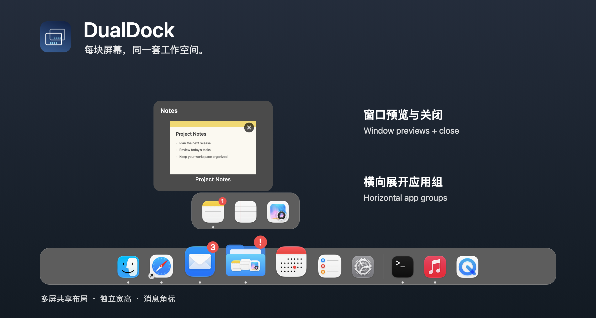
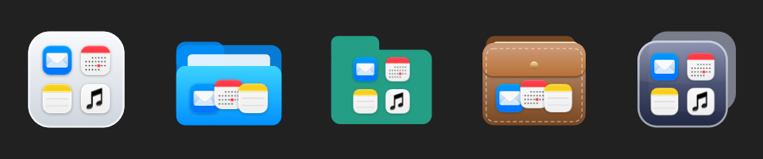
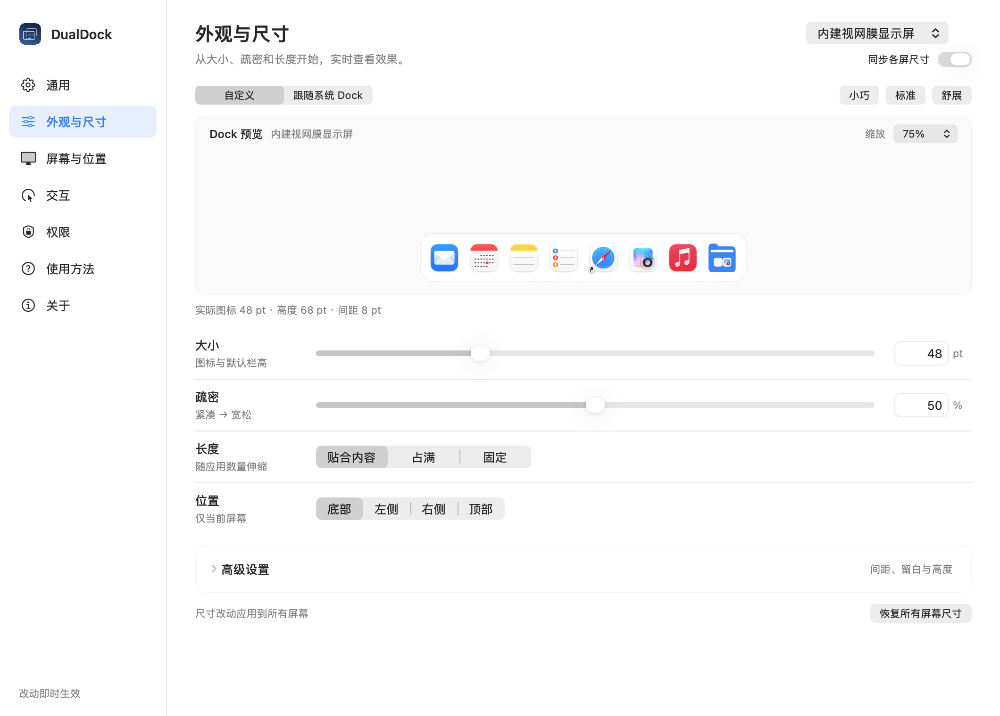

<div align="center">


# DualDock

### 应用有序收纳，Dock 多屏同在。

一款原生 macOS 多屏 Dock。把常用应用收进横向展开的应用组，悬停查看窗口，
在 MacBook 和外接显示器上使用同一套布局。

[](LICENSE)
[](#系统要求)
[](https://github.com/autumncry/DualDock/releases/latest)
[](https://github.com/autumncry/DualDock/releases/latest)

**简体中文** &nbsp;·&nbsp; [English](README.en.md)

[**下载最新版**](https://github.com/autumncry/DualDock/releases/latest) &nbsp;·&nbsp; [**从源码构建**](#从源码构建) &nbsp;·&nbsp; [**反馈问题**](https://github.com/autumncry/DualDock/issues)

</div>

<div align="center">
  
  <p><sub>演示布局，使用实际 AppKit 组件和示例内容绘制。</sub></p>
</div>

## 为什么选择 DualDock

工作空间从笔记本延伸到外接屏幕后，常用应用也应该随手可及。DualDock 围绕多屏和应用分组设计，让每块屏幕都保留熟悉的入口。

- **多屏共享。** 每个扩展屏幕都有一条 Dock，应用、分组、顺序和显示模式统一保存。
- **按工作方式整理。** 把相关应用归为一组，展开后横向排列，随时调整成员和顺序。
- **公开且可修改。** 使用 Swift、AppKit 和 SwiftUI 构建，源码采用 MIT 协议。

## 功能

### 每块屏幕都有 Dock

在 MacBook 内置屏和外接屏上同时显示 Dock。连接变化时自动调整，镜像屏幕由 macOS 复制对应画面。某块屏幕进入全屏应用时，该屏的 DualDock 自动隐藏；鼠标在对应边缘停留即可唤出，移开后再收起。

### 应用分组与拖拽整理

从 Finder 拖入应用，或在设置中添加。拖到图标边缘可排序；在另一个应用图标中央停留约 0.6 秒再松开，即可合成应用组。

点击文件夹图标横向展开。成员支持组内重排、移回主栏；右键可重命名或拆分应用组。首次启动会导入系统 Dock 的固定应用，之后独立保存。“重新导入”会补入缺少的应用，并保留已有分组。

右键点按尚未固定的活动应用，选择 **加入应用组 → 组名**，即可将它固定到该组末尾。也可以选择 **固定到 DualDock**，将图标单独放在固定区。把应用拖进文件夹时，图标会缩入组内；这些过渡遵循 macOS 的“减少动态效果”设置。

在 **设置 → Dock → 应用组外观** 中可为所有应用组选用银灰、经典蓝色文件夹、扁平、皮革或玻璃风格。背景颜色可自选，不透明度从 0% 到 100% 连续可调。调到 0% 时，成员图标、未读叹号和运行指示点仍清晰可见。



### 看清窗口，再切换或关闭

悬停运行中的应用查看窗口缩略图，点击预览切换到对应窗口。窗口提供可用的原生关闭操作时，右上角会显示 **×**。未保存内容仍由原应用提示确认。关闭后收起当前预览，再次悬停读取最新窗口列表。

无法取得有效截图的窗口不显示预览。截图仅在本机内存中处理，不保存到磁盘或上传。

### 选择窗口，反复点击切换

右键应用图标，菜单顶部会列出可操作窗口，包括已最小化窗口；勾选标记当前目标。选中后立即前置，后续点击图标继续操作同一个窗口，选择在本次运行中保留。

微信的独立浏览器图标也支持收起和还原同一网页。若多个微信窗口导致目标难以区分，可右键该图标，在“选择此图标控制的微信窗口”下点选目标。

- 窗口在后台：先前置。
- 普通窗口已在前台：点击最小化，再次点击还原。
- 全屏或最大化窗口：只激活，不最小化。

窗口操作使用原应用的系统动作，动画遵循 macOS 和目标应用的设置。窗口读取失败时不会改选并最小化另一个窗口；需要辅助功能权限。

### 两种显示模式

- **固定应用与分组 + 运行应用：** 保留常用入口，并显示未固定的运行应用。
- **仅正在运行的应用：** 平铺所有普通运行应用，包括隐藏、最小化和其他桌面的应用；切回普通模式会恢复原来的分组与排列。

显示模式在设置页切换，所有屏幕同步生效。

### 完全自适应系统 Dock

在“外观与尺寸”选择“跟随系统 Dock”后，基础图标大小、栏高度、图标间距、两端留白和悬停放大一起跟随系统 Dock。栏的长度随应用数量增减，并在所在屏幕边缘居中；悬停只改变图标，不改变底板。

系统模式隐藏手动尺寸与放大控件，也不支持边缘拖动。关闭后恢复原有手动配置。升级前已开启“自动调整 Dock 宽度”的用户会进入完整自适应模式。

尺寸通过只读系统偏好与辅助功能布局获取。系统 Dock 暂时不可读时沿用最近一次有效尺寸；没有历史值时采用兼容值。辅助功能边界与系统实际绘制可能存在差异，不保证逐像素一致。

### 简化尺寸设置与布局示例

常用设置只保留三个入口：

- **大小：** 直接设置图标尺寸，默认栏高自动计算。
- **图标间距：** 0–100 连续调节。0 让相邻图标的可见边界贴合，100 留出约一个图标宽度的间隔；按图片内容排列，保留原始图标大小与形状。
- **长度：** 贴合内容、占满可用边长，或按屏幕比例固定。

高级设置提供留白、Dock 高度、固定长度比例、对齐方式及“先缩小图标再滚动”；点击箭头、标题或标题行空白处均可展开和收起。新间距模式在空间不足时保留间距比例，按选项缩小图标或滚动，不显示滚动条。布局示例使用五个固定图标，随大小、间距、长度和位置变化，不读取实际打开的应用列表。

升级保留已有尺寸和外观；首次调整新的间距滑块后，才启用按可见图标边界计算的规则。也可恢复当前作用范围内的推荐尺寸。

### 每屏位置与边缘拖动

每块屏幕可独立选择**底部、顶部、左侧或右侧**。上下横排，左右竖排，图标保持正向；应用组横向展开，弹窗朝屏幕内侧显示。位置页提供可点击的屏幕示意图。

拖动内侧边调整高度并按比例改变图标，拖动两端调整长度，拖动内侧两个角同时缩放两轴。贴合内容时，两端拖动会重新设定留白。

“同步各屏尺寸”使用所有屏幕共同可用的范围；关闭后，每屏独立设置。重新开启时采用当前选中屏幕的尺寸。高度上限仍为适用屏幕可用短边的 **12%**，长度上限为可用边长，单位为 macOS 逻辑点。

### 调整放大曲线

在手动模式的“交互”页，使用两个连续滑块独立调整悬停效果：

- **放大峰值：** 指针下的图标最多放多大。
- **联动范围：** 两侧有多少图标跟着放大；收窄范围可以减小相邻图标的放大效果。

曲线预览会随滑块更新，Dock 底板保持稳定。关闭悬停放大后，两项控件停用；开启完全自适应时仍跟随系统 Dock，不提供手动曲线调节。原手动峰值保留，新增联动范围默认延续旧版效果。

### 自动隐藏与边缘唤出

要让 Dock 在普通桌面上也自动收起，打开 **设置 → 交互 → 窗口与预览 → 自动隐藏 Dock**。指针停留在当前屏幕的 Dock 边缘即可唤出，移开后自动收起。各屏幕独立响应。

可在“交互”页开启“最大化窗口时隐藏 Dock”。窗口铺满某块屏幕的工作区时，只隐藏该屏的 Dock；鼠标移到对应边缘稍作停留即可唤出。普通窗口即使向下移动并盖住 Dock，也不会因重叠触发隐藏。顶部 Dock 的唤出位置在菜单栏下方。

使用应用夹、窗口预览、右键菜单或拖拽时保持显示，离开后再收起。全屏应用也支持边缘唤出；全屏自动隐藏独立于这个开关。该选项默认关闭，不调整其他应用的窗口尺寸。

### 分页设置

设置顶部提供 **Dock、交互、通用、支持** 四个原生工具栏分类。左侧选择具体设置，按 **⌘F** 可跨分类搜索中英文名称和关键词，例如“角标大小”。设置页共用一个可调整大小的窗口。切换页面、展开高级选项或切换语言时，窗口保持原位，较长的内容在右侧滚动。“交互”和“通用”中的相关设置连续排列，点击侧栏可直接跳到对应位置。窗口与系统明暗外观同步。“关于”页提供版本、MIT 协议和项目链接。

在**通用 → 显示语言**可切换简体中文和 English，选择会立即应用并在下次启动时保留。

在“通用”中可开启**登录时启动**。状态由 macOS 登录项管理；如需系统批准，会显示进入系统设置的入口。默认不主动注册登录项。



<sub>原生设置页截图，使用隔离的示例配置。</sub> · [查看「窗口与预览」页面](docs/images/window-previews-settings.png)

### 更多细节

- **消息角标：** 单个应用显示系统提供的数量或标签，组内有未读提醒时显示红色 **!**；在“交互 → 消息提醒 → 角标大小”中可从 75% 到 200% 连续调整数字和叹号，默认 100%。所有屏幕和已展开的分组同时更新。可统一关闭。只读取角标状态，不读取通知正文。部分应用可能不提供可用角标。
- **系统 Dock 管理：** 可选择隐藏系统 Dock；正常退出时恢复由 DualDock 修改的设置，异常退出后在下次启动时恢复，并保留之后手动更改的项目。菜单栏也提供手动恢复入口。
- **方便进入设置：** 右键 Dock 空白处，或点击菜单栏的双矩形图标。
- **本地配置：** 分组、排列和设置保存在 `~/Library/Application Support/DualDock/`，升级时按需保留迁移前备份。

## 下载与安装

前往 [Releases](https://github.com/autumncry/DualDock/releases/latest) 下载最新的 `DualDock-版本号-arm64.dmg`，以及可选的 SHA-256 校验文件。

1. 打开 DMG，将 `DualDock.app` 拖入 `Applications`。
2. 从“应用程序”启动 DualDock，在“权限”页授予**屏幕录制**和**辅助功能**权限。
3. 在设置中选择显示模式、自适应或手动尺寸，并为各屏设置位置，再通过拖拽整理应用组。系统 Dock 隐藏默认关闭，可按需启用。

屏幕录制用于窗口缩略图；辅助功能用于匹配、切换和关闭窗口，以及读取系统 Dock 的布局和角标。权限变更后如未生效，请退出并重新打开 DualDock。更新时保留本地配置。

> [!NOTE]
> 当前发布包面向 Apple Silicon，采用个人自用的 ad-hoc 签名，尚未经过 Apple 公证。首次安装遇到系统提示时，请参阅[安装说明](docs/installation.txt)。

DMG 附带 **首次安装 - First Launch.html**。双击后可离线查看中英文首次启动指南，点击“复制命令”后可将命令粘贴到终端。

**后续更新**：从 2.8.0 起，在 **设置 → 支持 → 关于 DualDock** 点击 **检查更新**。有新版本时可查看变更，确认后下载、验证并重启安装。2.7.0 及更早版本需要先手动安装一次带更新器的版本。

<!-- first-launch-guidance:start -->
### 首次启动：Apple 无法验证或无法验证开发者

当前发布包尚未经过 Apple Developer ID 签名和公证，首次打开可能出现“Apple 无法验证 DualDock 是否包含恶意软件”或“无法验证开发者”。**仅当安装包来自本项目的[官方 Releases](https://github.com/autumncry/DualDock/releases/latest)，且你确认来源可信、文件未被篡改并决定继续时**，按以下步骤允许这一个应用：

1. 将应用拖入“应用程序”后，先尝试打开 DualDock；出现上述提示后关闭提示。
2. 打开 **系统设置 → 隐私与安全性**，向下滚动到“安全性”，找到 DualDock 的阻止记录，点击 **仍要打开（Open Anyway）**；部分系统会先显示“打开”入口。
3. 按系统要求验证登录密码或 Touch ID，然后在确认提示中选择“打开”。之后可正常双击启动。
4. 如果没有找到该按钮，再次尝试打开“应用程序”中的 DualDock，然后返回此页面。Apple 说明此入口通常在尝试启动后约一小时内可用；受管理的 Mac 可能需要联系管理员。

#### 可选：使用终端打开

如果你选择命令行方式，请先确认应用来自上方官方 Releases、来源可信且未被篡改，并已复制到 `/Applications/DualDock.app`。打开“终端”，依次执行：

```sh
xattr -dr com.apple.quarantine "/Applications/DualDock.app"
open "/Applications/DualDock.app"
```

第一条命令仅移除这个应用包及其内部文件的 `com.apple.quarantine` 隔离属性，不清除其他扩展属性，也不关闭系统整体的 Gatekeeper。第二条启动应用。这不会为应用签名或公证，也不会授予辅助功能或屏幕录制权限；这些权限仍在首次使用时单独授权。请保持完整路径不变，不要默认添加 `sudo`；如遇权限错误，可使用上方系统设置方式。

该方法经用户本机验证可用，但未覆盖所有 Mac 和 macOS 版本。

如果提示明确指出应用“将损坏你的电脑”、检测到恶意软件或“已损坏”，请停止打开，从官方 Releases 重新下载并核对 SHA-256；仍有提示时[反馈问题](https://github.com/autumncry/DualDock/issues)。这与“无法验证开发者”不同，不应按上述流程放行。无需关闭系统的整体安全保护。

Apple 说明：[安全地打开 Mac 上的 App](https://support.apple.com/en-us/102445)、[单个应用的打开入口与有效时间](https://support.apple.com/en-gb/guide/mac-help/mh40617/mac)。
<!-- first-launch-guidance:end -->

## 从源码构建

```sh
git clone https://github.com/autumncry/DualDock.git
cd DualDock
./script/build_and_run.sh
```

这是一个 Swift Package Manager 项目，无需创建 Xcode 工程。脚本会先请求已运行的 DualDock 正常退出，再构建、打包、本地签名并启动 `dist/DualDock.app`。

### 系统要求

- 运行环境：macOS 14 或更新版本；当前 DMG 为 Apple Silicon（arm64）构建。
- 当前应用界面为简体中文。
- 构建环境：支持 Swift tools version 5.9、包含相应 macOS SDK 的 Xcode 或命令行工具。

### 构建与检查命令

```sh
./script/build_and_run.sh --build-only # 生成 .app，不启动
./script/build_and_run.sh --verify     # 构建、启动并确认进程
./script/package_dmg.sh               # release 构建、DMG 与 SHA-256
swift test -c release                 # 模型、布局和窗口策略回归
./script/check_dock_views.sh          # 隐藏 AppKit 组件检查
./script/check_four_edge_views.sh     # 四向布局、滚动与输入路由检查
./script/check_display_sizing_store.sh # 各屏尺寸、同步与拖动提交检查
./script/check_native_dock_metrics.sh # 原生 Dock 尺寸读取与回退检查
./script/check_dock_animation.sh      # 悬停重绘、布局与角标回归
./script/check_terminal_hover.sh      # 两端放大、移出与滚动位置回归
./script/check_dock_visibility.sh     # 可见性刷新时序与生命周期
./script/check_fullscreen_fallback.sh # 全屏异步回退与过期结果保护
./script/check_window_obstruction.sh  # 遮挡读取、缓存与请求合并
./script/check_application_activation.sh # 应用与辅助进程激活路由
./script/check_badges.sh              # 角标读取与异步状态检查
./script/check_system_dock.sh         # 隔离环境下的系统 Dock 恢复检查
```

构建运行脚本也支持 `--logs`、`--telemetry` 和 `--debug`。测试实例可通过 `.app` 启动参数 `--config-dir <目录>` 使用独立配置，或用 `--diagnostics <JSON 路径>` 输出布局诊断。

## 文档

- [安装说明](docs/installation.txt)
- [验证记录与已知边界](docs/validation.md)
- [实现分析与初始设计](docs/superpowers/specs/2026-11-09-dualdock-design.md)
- [2.0 自适应、每屏位置与拖动尺寸设计](docs/superpowers/specs/2026-11-10-four-edge-adaptive.md)
- [2.1 可见性、激活与动画修正](docs/superpowers/specs/2026-11-11-visibility-and-motion.md)

窗口身份匹配和全屏检测使用可选的 macOS 私有接口，并提供回退。系统升级后可能需要适配；最小化、其他桌面和受保护窗口的预览及操作能力取决于目标应用和 macOS。

## 反馈与贡献

欢迎通过 [Issues](https://github.com/autumncry/DualDock/issues) 报告问题或建议。描述问题时，请附上 DualDock 与 macOS 版本、显示器配置和复现步骤；截图前请遮盖私人内容。也欢迎提交 Pull Request。

README 的展示结构参考了 [Docky](https://github.com/josejuanqm/docky)，文案、图标和演示内容描述的是 DualDock 自身。

## 依赖

无第三方 Swift Package 依赖。主要使用 AppKit、SwiftUI、ScreenCaptureKit、Accessibility 和 CoreGraphics 等系统框架。

## 许可证

[MIT License](LICENSE)。Copyright © 2026 Ronny Cao。
