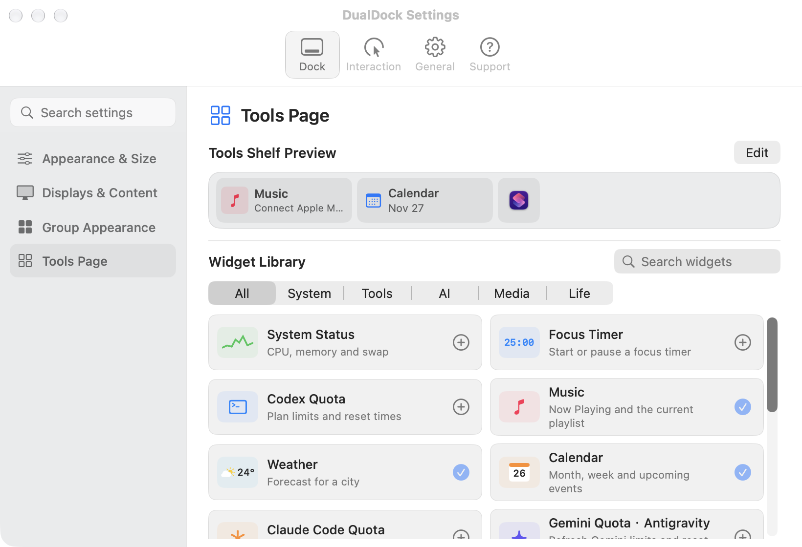

# Using DualDock’s tools page

With the pointer over a horizontal Dock, swipe up with two fingers for Tools and down for Apps. For a vertical Dock, swipe across it. The menu bar page command works with a mouse. Flipping pages keeps the active app window in place. Each display tracks its own page.

Open **Settings → Dock → Tools Page → Edit**. Drag in widgets, move or remove them, change a card’s width (1–4 slots), or stack related cards. **Done** saves the arrangement for all displays. **Cancel** discards the draft.

## AI quota cards

- **Codex** connects to the local Codex CLI and reads the signed-in account’s limits. You can select the executable if it was installed outside standard locations.
- **Gemini · Antigravity** reads Gemini model quota from Antigravity CLI 1.1.11 or later. Run `agy` once to sign in, then click the card. The refresh button requests another reading. Pin a window to choose which one appears in the Dock.
- **Claude Code** reads the official CLI’s built-in `/usage` command on verified versions (2.1.332 in this release). A Claude.ai subscription is needed for plan limits. The CLI can return a recent cached result; **Read at** records the local read time. An explicitly connected status line can supply a labeled fallback. If the preview already installed the callback, choose **Connect Claude Code Status Line** in the released app to adopt its verified wrapper and preserve your original command. If verification fails, quit DualDock, disconnect the status line in the previous installation, quit it and reconnect in the release.
- **Cursor** asks which plan to query. The legacy Cursor CLI option is experimental and reads the official interactive usage screen. Sign in to the Cursor CLI with your Cursor account. Choose the X option only if Cursor and Grok use the same X Subscription. A missing allowance is shown as unavailable. A reset date is displayed with the precision supplied by the service. Paid Cursor balances and reset dates were not verified against a live subscriber in this release. [Cursor plan details](https://cursor.com/help/models-and-usage/usage-limits)

## Music, calendar and utilities

Click Music for album art, playback controls, seeking and the current playlist in Apple Music. Select a week or month in Calendar, then pick a day to see its events. Calendar access is optional for browsing dates. System Status shows CPU, RAM and swap; battery and disk have their own cards. The library also includes focus timers, weather, Shortcuts and custom app, file or URL launchers.

Settings live in `~/Library/Application Support/DualDock/`. The first upgrade gives detected preview settings priority and backs up an existing release configuration to the sibling `DualDock Backups/` directory. An old preview login item can be disabled separately in macOS Login Items.
