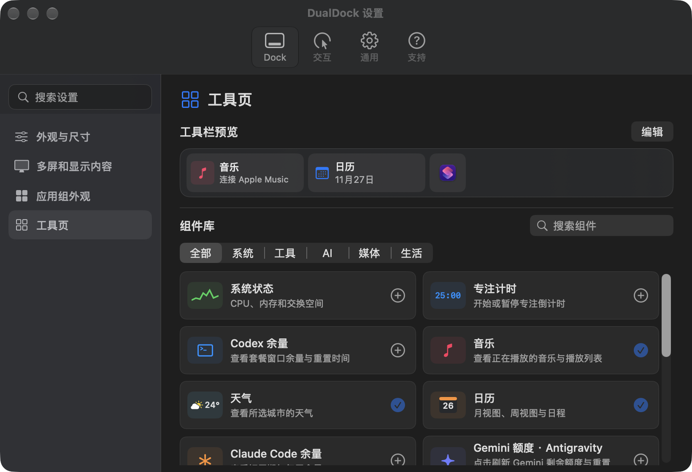

# DualDock 工具页使用指南

## 切换和排列

1. 首次启动时，DualDock 从 macOS 原生 Dock 导入固定应用，默认停靠在屏幕底部。在「设置 → Dock → 多屏和显示内容」可以为每块屏幕选择位置。已有用户升级后保留配置。
2. 将指针放在水平 Dock 内，双指向上滑到工具页，向下滑回应用页。左右停靠的栏用横向手势切页。沿 Dock 长轴滑动仍用于浏览溢出的项目。没有触控板时可通过菜单栏的「切换本屏应用页与工具页」操作。
3. 在外接屏翻到工具页，再到内屏打开应用。两块屏幕独立记住当前页。翻页保持原来应用的前台窗口。
4. 打开「设置 → Dock → 工具页」，顶部的虚拟工具栏展示当前排列。点「编辑」，从下方组件库拖入卡片，拖动卡片调整位置，或拖回组件库、移除区。选中卡片后可拖动右侧手柄或选择 1–4 格宽度，在更多菜单中叠放或拆分。点「确定」后各屏一起使用新排列，点「取消」可放弃这次编辑。

## 自动隐藏

在「设置 → 交互 → 窗口与预览」开启「自动隐藏 Dock」。将指针移到该屏 Dock 所在的那段边缘，稍停即可唤出。移开后，该屏的 Dock 会收起。顶部停靠时，触发位置在菜单栏下沿。关闭「自动隐藏 Dock」后，全屏仍会自动隐藏，普通窗口铺满工作区时则使用原先的「最大化窗口时隐藏 Dock」设置。

## 工具及数据来源

- **音乐**显示本机「音乐」App 的当前曲目。点卡片展开播放器，可查看封面、曲名和歌手、拖动进度、切换上下曲或暂停／继续。点列表按钮查看当前播放列表并点歌，点封面可前往「音乐」App。首次在播放器中点「连接 Apple Music」时，macOS 可能请求自动化权限。
- **日历**卡片保留下一项日程。点开后默认显示本月，可切换到周视图；下次打开时沿用上次选择。浏览日期无需日历权限。要查看日程，在卡片中允许读取日历后，点选日期即可查看当天的安排。
- **天气**在工具设置里搜索并选择城市，城市搜索使用 [Open-Meteo](https://open-meteo.com/) 和 GeoNames。近时预报优先使用 [MET Norway](https://www.met.no/en)，备用数据源为 Open-Meteo。详情显示数据来源、有效时间和摄氏温度，各屏共享天气缓存。
- **快捷入口**支持应用、文件或文件夹、网站和系统快捷指令。运行快捷指令时填写你已在「快捷指令」App 中保存的名称。
- 点开 **系统状态**，可在同一个弹窗查看 CPU 使用率、已用与总内存，以及已用与已分配的交换空间（Swap）。电池和可用磁盘空间各有独立卡片。专注计时器可开始、暂停、还原，重新打开应用后仍按已保存的截止时间计算。

## AI 余量

在组件库选择「AI」，把所需服务加入草稿并确定。点击实际 Dock 上的额度卡连接数据。未连接、暂无数据、读数过期和额度耗尽会分别显示。各屏共享查询，详情可以固定要在 Dock 显示的窗口或模型。

- **Codex** 通过本机已登录的 Codex CLI 只读查询账户限额。按服务返回的窗口展示剩余比例和重置时间。若未自动找到 CLI，可以在详情中选择它。
- **Claude Code** 点击卡片后调用本机的官方 Claude Code 内置 `/usage`。不用等待一次模型回复。官方 CLI 可以复用近期缓存，因此「读取于」表示本机读取时间。使用 Claude.ai 订阅账号；API key 会话的费用与 token 数不能换算成订阅余额。本次已验证 Claude Code 2.1.332。其他版本可在终端打开官方 `/usage` 查看。已连接的状态行提供单独标注的备用读数。曾在试用版启用状态行的用户可在新版额度卡中点击「启用备用状态行」。确认后将接替可验证的旧回调并保留原有命令。如果旧安装无法验证，请退出新版，在原试用版中断开状态行，退出试用版后回到新版重新启用。
- **Cursor** 首次打开卡片时选择自己的套餐。旧版 Cursor 套餐使用官方 Cursor CLI 的交互用量页（试验性），需要单独登录 Cursor CLI。X 共享额度仅适用于 Cursor 与 Grok 属于同一 X 订阅的账户。CLI 返回周期、百分比或重置日期时按原始精度展示。没有套餐读数时可以打开官方用量页；付费卡的真账号余额及重置日期本次未作实号对照。[Cursor 官方额度说明](https://cursor.com/help/models-and-usage/usage-limits)
- **Gemini 额度 · Antigravity** 使用本机 Antigravity CLI 已登录的账号，显示 Gemini 模型共享的额度和重置时间。

### 怎样刷新 Gemini 额度

1. 首次使用时，在终端运行 `agy`，按 Google 提示登录。若已在这台 Mac 登录，可直接打开工具页。查询需要 Antigravity CLI 1.1.11 或更高版本。[Antigravity 安装与登录](https://antigravity.google/docs/install/)
2. 在「设置 → Dock → 工具页」点「编辑」，从「AI」加入「Gemini 额度 · Antigravity」并确定。之前已添加 Gemini 卡片的用户可直接使用原来的位置。
3. 点击实际 Dock 上的卡片即可查询。详情展示服务返回的剩余额度、重置时间和本次更新时间；保持面板展开时，也可以点「刷新」。图钉决定 Dock 优先显示哪个周期。[额度与重置规则](https://antigravity.google/docs/cli/commands/usage/)

DualDock 调用官方只读命令 `agy -p /usage --output-format json`。每次点击查询时复用 CLI 登录状态，不会发起模型对话。已有的 Gemini CLI 手动快照可在详情里单独查看。[Google 版本说明](https://antigravity.google/docs/changelog#rel-cli-1.1.11)

## 屏幕录制权限

进入「设置 → 通用 → 权限」并点击「打开屏幕录制设置」。若列表中没有正在试用的应用，展开提示，可请求系统登记，或在访达定位此 App 后通过系统设置的「＋」添加。返回应用会自动复查状态。若 macOS 要求重启，请重新打开 DualDock。

## 系统 Dock 与数据

在「设置 → 通用 → 系统 Dock」开启「隐藏系统 Dock」。关闭开关、点「恢复系统 Dock」或正常退出时，会撤销 DualDock 自己做的修改。

配置保存在 `~/Library/Application Support/DualDock/`。首次升级会优先沿用已检测到的试用版配置；若正式版目录已存在，会先备份到同级的 `DualDock Backups/`。曾为试用版单独启用登录启动的用户，可在 macOS 的登录项中关闭旧条目。
